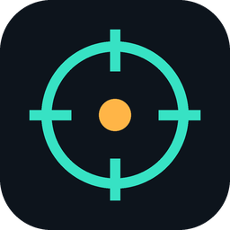
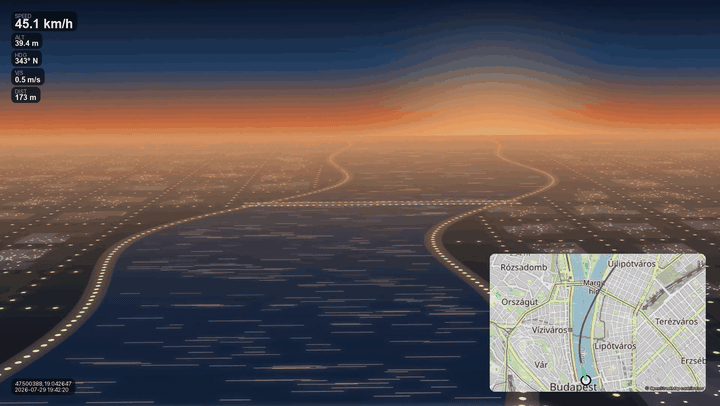
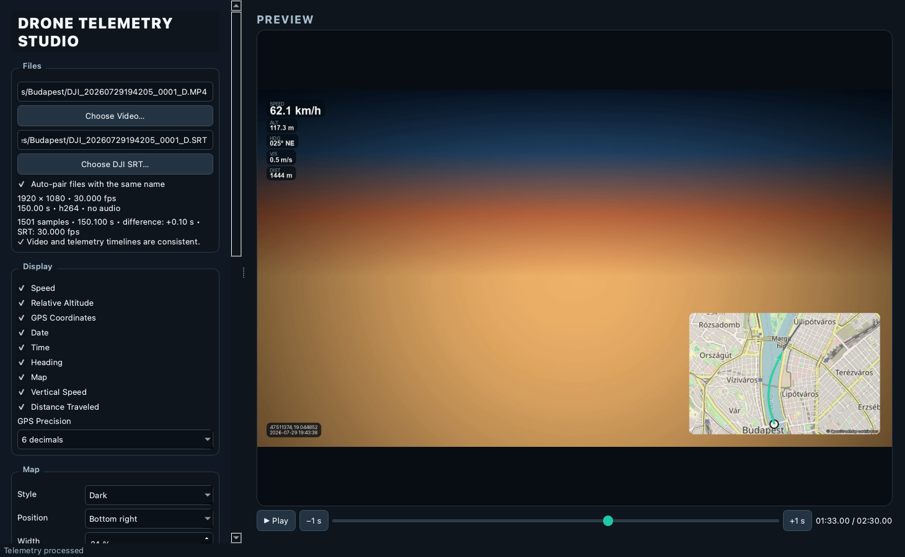
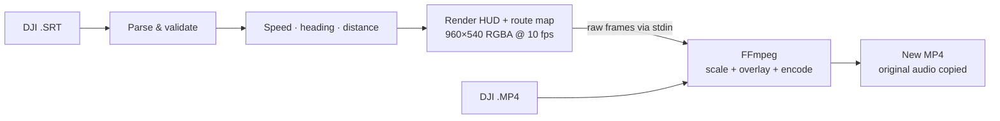

<div align="center">



# Drone Telemetry Studio

**Burn your DJI flight data (speed, altitude, GPS, heading) and a live route map onto your drone videos.**<br>
Free, open source, and 100% local. Your footage never leaves your Mac.

[](https://github.com/horakdani/Telemetry_Overlay/actions/workflows/ci.yml)
[](LICENSE)


[**Website**](https://horakdani.github.io/Telemetry_Overlay/) ·
[**Download**](https://github.com/horakdani/Telemetry_Overlay/releases/latest) ·
[Quick start](#-quick-start) ·
[How it works](#-how-it-works) ·
[FAQ](#-faq)

<br>
<sub>Synthetic demo flight along the Danube in Budapest, sped up 8×. Map © OpenStreetMap contributors.</sub>

</div>

---

## ✨ Why

DJI drones record a `.SRT` subtitle file next to every video, full of GPS, altitude
and camera data. Most tools that turn it into an on-screen display are paid,
cloud-based, or need a video editor. **Drone Telemetry Studio** does it in one click,
offline, and never touches your original files.

## 🚀 Features

|  |  |
|---|---|
| 🎯 **Accurate motion data** | Haversine distance over ≥ 0.5 s windows, GPS-jump rejection, time-based smoothing. Speed you can trust, not GPS jitter. |
| 🗺️ **Live route map** | Fixed mini-map framing the whole flight: full path, path so far, start point, drone marker, north arrow. OpenStreetMap background or a fully offline cinematic style. |
| 🎛️ **Configurable HUD** | Toggle speed, relative altitude, GPS (4–6 decimals or hidden), date, time, heading, vertical speed and distance. |
| 🎞️ **Frame-accurate preview** | Scrub the real video frame with the HUD on top; fix sync with a ±0.01 s telemetry offset. |
| ⚡ **Hardware encoding** | Auto-detects `h264_videotoolbox` / `hevc_videotoolbox` on Apple Silicon, with `libx264` / `libx265` fallbacks. |
| 🔒 **Private & safe** | No account, no uploads. Exports always go to a *new* file; original audio and VFR timestamps are preserved; cancel cleans up. |

<p align="center">
  
</p>

## 📦 Quick start

**Requirements:** macOS 13 or newer (Apple Silicon recommended; Intel should work but
is untested), and [FFmpeg](https://ffmpeg.org/) via [Homebrew](https://brew.sh/).

### Option A: download the app

```bash
brew install ffmpeg
```

Then grab the latest `.zip` from **[Releases](https://github.com/horakdani/Telemetry_Overlay/releases/latest)**,
unzip it, and **right-click → Open** the first time (the build isn't notarized yet).

### Option B: run from source

```bash
brew install python ffmpeg
git clone https://github.com/horakdani/Telemetry_Overlay.git
cd Telemetry_Overlay
python3 -m venv .venv
.venv/bin/pip install -e '.[dev]'
./scripts/verify_environment.sh
./scripts/run_dev.sh
```

## 🎬 Usage

1. **Turn on subtitles on your drone.** In DJI Fly, enable *Video Subtitles* in the camera
   settings so a `.SRT` is written next to each `.MP4`.
2. Click **Choose Video…** and pick the MP4. A same-named `.SRT`/`.srt` next to it is
   paired automatically; otherwise use **Choose DJI SRT…**.
3. Check the file and validation summary (FPS, VFR, duration, audio, GPS warnings).
4. Scrub the timeline: FFmpeg grabs the real frame and draws the current HUD on it.
5. Adjust visible fields, GPS precision, map style/corner/size and the **telemetry
   offset**. A positive offset shows a later SRT sample at the same video time.
6. Pick an output name, encoder and quality, then **Start Export**. **Cancel** stops
   FFmpeg and removes the partial file.

## 🛠 How it works



- **One FFmpeg pass, no giant temp files.** Instead of rendering a transparent
  intermediate video, the HUD is streamed as raw RGBA frames into the *same* FFmpeg
  process that decodes your 1080p/4K source, upscales the HUD with Lanczos, overlays
  and encodes. Only the current HUD frame is held in memory.
- **Robust SRT parsing.** Block-by-block (not one fragile regex): HTML tags, bracketed
  fields and key–value pairs are split safely; UTF-8 BOMs, optional fields and broken
  blocks are handled; bad GPS points become warnings, not crashes.
- **Physically sane telemetry.** Speed from ≥ 0.5 s windows instead of 16 ms records,
  jumps faster than 45 m/s (configurable) dropped from route and distance, heading held
  while hovering. All internal values are SI units.

More detail in [docs/ARCHITECTURE.md](docs/ARCHITECTURE.md).

## 🗺 Map, network & cache

The default map background uses [OpenStreetMap](https://www.openstreetmap.org/) tiles.
Only the tiles for the current fixed view are requested, with a custom User-Agent,
conditional requests and a cache of at least 7 days at
`~/Library/Caches/DroneTelemetryStudio/tiles` (clearable from the UI). There is no
area or zoom-level prefetching, in line with the
[OSMF Tile Usage Policy](https://operations.osmfoundation.org/policies/tiles/).
If the network fails, the offline background is used. Untick
**OpenStreetMap background (online)** to make zero network requests. Attribution is
always shown on the map.

## 🧪 Development

```bash
QT_QPA_PLATFORM=offscreen .venv/bin/pytest -q                                   # unit, integration, GUI
PYTHONPATH=src .venv/bin/python scripts/generate_demo_assets.py                 # demo clip + HUD preview
QT_QPA_PLATFORM=offscreen PYTHONPATH=src .venv/bin/python scripts/capture_gui_screenshot.py
./scripts/build_macos.sh                                                        # dist/Drone Telemetry Studio.app
```

The README and website media are reproducible too:

```bash
PYTHONPATH=src .venv/bin/python scripts/generate_showcase.py       # demo.gif, demo.mp4, hud-preview.png
PYTHONPATH=src .venv/bin/python scripts/generate_brand_assets.py   # logo.png, social-preview.png
```

`generate_showcase.py` accepts `--video` and `--srt` to build the demo from a real flight.

The test suite needs no network and no real footage: it generates a short clip with
FFmpeg and uses [`samples/DJI_DEMO.SRT`](samples/DJI_DEMO.SRT). CI runs it on macOS for
every push and pull request. Pushing a `v*` tag builds the `.app` and attaches it to a
GitHub release.

<details>
<summary><b>Project layout</b></summary>

```text
src/drone_telemetry_studio/
├── domain/      data models & settings (no GUI)
├── parsers/     DJI SRT parser
├── telemetry/   validation, geodesy, smoothing, interpolation
├── map/         route-map geometry, renderer, OSM tile cache
├── overlay/     RGBA HUD renderer (Pillow)
├── media/       ffprobe, encoder discovery, export pipeline
├── ui/          PySide6 main window, preview, QThread workers
└── app/         bootstrap, styling, platform paths
```
</details>

## 🧯 Troubleshooting

- **Logs:** `~/Library/Application Support/DroneTelemetryStudio/logs/`, or click **Open Log** in the app.
- **No preview?** Check `ffmpeg -version` and `ffprobe -version`.
- **Hardware encoder fails?** Switch to *H.264 – Software*.
- **"Output already exists"?** This is intentional: the app never overwrites files. Pick a new name.

## ❓ FAQ

<details><summary><b>Which drones are supported?</b></summary>

DJI drones that write the bracketed SRT format, e.g.
`[latitude: 47.45] [longitude: 19.05] [rel_alt: 52.3 abs_alt: 96.4]`, as recorded by
recent DJI Fly models. Older layouts such as `GPS(lon, lat, alt)` aren't supported yet.
[Open an SRT format issue](https://github.com/horakdani/Telemetry_Overlay/issues/new?template=srt_format.yml)
with a few blocks and it can be added.
</details>

<details><summary><b>Windows / Linux?</b></summary>

The core is plain Python + Qt + FFmpeg and largely portable, but only macOS is tested
and packaged today. PRs welcome!
</details>

<details><summary><b>Does it re-encode my video?</b></summary>

Yes, because burning in an overlay requires it. You choose the encoder and quality;
the original audio track is copied as-is.
</details>

## 🗺 Roadmap

- [ ] Follow-cam map mode (map centred on the drone)
- [ ] Notarized, signed builds and an Intel build
- [ ] More SRT layouts (older DJI models, `GPS(...)` format)
- [ ] HUD themes and custom fonts
- [ ] Batch export

Ideas and votes are welcome in [Issues](https://github.com/horakdani/Telemetry_Overlay/issues).

## ⚠️ Known limitations

- The map is a fixed route overview; a drone-following camera is not implemented yet.
- The HUD updates at 10 fps by default; the video itself keeps its original FPS and timestamps.
- Bulk/offline area downloads from the public OSM tile server are prohibited, so the app doesn't offer them.
- The `.app` is not code-signed or notarized; Intel builds must be built and tested on an Intel Mac.

## 🤝 Contributing

Bug reports, SRT samples from other models and pull requests are very welcome. See
[CONTRIBUTING.md](CONTRIBUTING.md). For security issues, see [SECURITY.md](SECURITY.md).

## 📄 License

The source code is [MIT](LICENSE) licensed. Third-party components (Qt/PySide6, Pillow,
FFmpeg, PyInstaller, OpenStreetMap data) are listed in
[THIRD_PARTY_LICENSES.md](THIRD_PARTY_LICENSES.md). FFmpeg is **not** bundled; install
it separately.

Map data © [OpenStreetMap contributors](https://www.openstreetmap.org/copyright).
DJI is a trademark of SZ DJI Technology Co., Ltd.; this project is not affiliated with DJI.

<div align="center"><sub>If this saved you an afternoon in a video editor, consider leaving a ⭐</sub></div>
