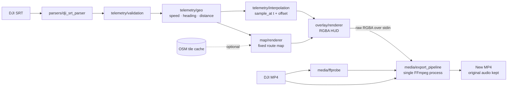

# Architecture and design decisions

Drone Telemetry Studio is a small, layered desktop application. The GUI is a thin
shell over pure-Python modules that can be tested without Qt, a display, or a network.



## Layers

| Package | Responsibility |
|---|---|
| `domain` | GUI-independent data models and settings (`TelemetrySample`, `OverlayConfig`, `ExportConfig`, `VideoMetadata`). |
| `parsers` | Block-by-block DJI SRT parser: UTF-8/BOM handling, optional fields, tolerant of malformed blocks. |
| `telemetry` | Validation, geodesy (Haversine), outlier rejection, smoothing and time interpolation. |
| `map` | Fixed route map that frames the whole flight; Web Mercator geometry; optional OSM raster tiles with an on-disk cache. |
| `overlay` | Resolution-independent RGBA HUD renderer built on Pillow. |
| `media` | FFprobe metadata, encoder discovery, preview-frame extraction and the single-process FFmpeg export. |
| `ui` | Qt Widgets interface; every long-running operation runs in a `QThread` worker. |
| `app` | Application bootstrap, styling and platform paths (`~/Library/...`). |

## Telemetry processing

- **Speed** is derived from the distance covered over a window of at least 0.5 s,
  not from consecutive 16–17 ms records, which would amplify GPS jitter.
- **Distance** uses the Haversine formula. Physically impossible jumps (default:
  faster than 45 m/s) are excluded from the route and from cumulative distance.
- **Display speed** gets time-based exponential smoothing; the raw value is kept in a
  separate field.
- **Heading** only updates while the drone is reliably moving and holds the last
  value while hovering.
- All internal values are SI units; formatting happens only at render time.

## Map prototype

`scripts/prototype_map_backends.py` benchmarks the Pillow renderer and checks what a
MapLibre/Playwright headless backend would need (Chromium, Playwright, MapLibre JS and
a style/tile source). The Pillow renderer was chosen: it is deterministic, needs no
browser runtime, renders a fully offline base map, and the fixed background can be
cached. It can optionally composite raster tiles, but only for the current fixed view
and only when the user enables it.

## Export strategy

A transparent intermediate video would be easy to blend, but for long 4K footage it
would need a lot of temporary disk space. Instead, a 960×540 RGBA HUD stream (10 fps by
default) is piped straight into the **same** FFmpeg process that decodes the original
video and encodes the final MP4:

```text
ffmpeg -i input.mp4 \
       -f rawvideo -pixel_format rgba -video_size 960x540 -framerate 10 -i pipe:0 \
       -filter_complex "[1:v]scale=W:H:flags=lanczos,format=rgba[hud];[0:v][hud]overlay=0:0[v]" \
       -map [v] -map 0:a? -c:a copy -c:v <encoder> ... output.part.mp4
```

The original timestamps (including VFR), resolution and audio are preserved. FFmpeg
scales and blends the HUD. The command is built as an argument list — no shell, no
string interpolation of user paths. Output is written to a hidden `.part.mp4` file and
only renamed on success; cancelling terminates FFmpeg and deletes the partial file.

## Privacy

The offline route map makes no network requests at all. The OSM tile mode is a
separate, explicit toggle, and even then the video and SRT never leave the machine.
The tile URL is configurable, tiles are served from the cache when possible, the cache
lives for at least seven days, and there is no bulk prefetching.
